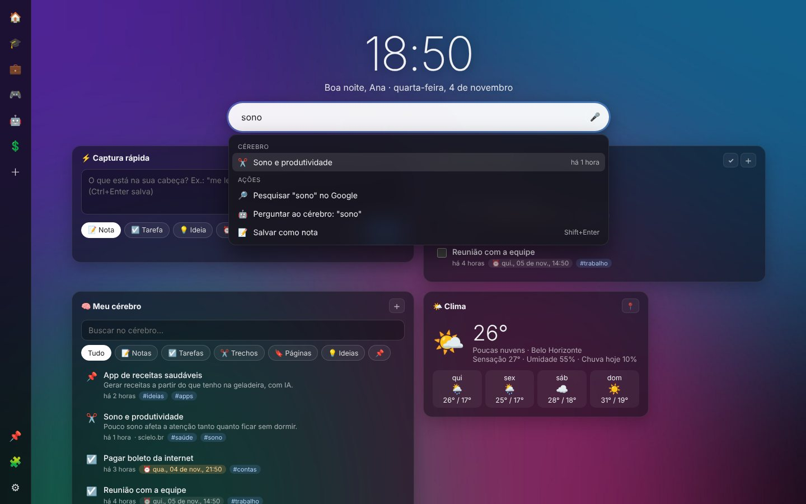

<p align="center">
  
</p>

<h1 align="center">NeuroTab</h1>

<p align="center">
  <b>A nova aba que pensa com você.</b><br>
  Atalhos numa barra lateral e, no centro, um segundo cérebro com notas, lembretes, clima, cotações e IA.<br>
  Para Edge e Chrome. Gratuita, de código aberto, sem anúncios e sem rastreamento.
</p>

<p align="center">
  <a href="https://mpjbiologo.github.io/NeuroTab/"><b>🌐 Site do projeto</b></a> ·
  <a href="https://github.com/mpjbiologo/NeuroTab/releases/latest"><b>⬇ Baixar</b></a> ·
  <a href="#-apoie-o-projeto"><b>❤ Apoiar</b></a>
</p>

<p align="center">
  <a href="https://github.com/mpjbiologo/NeuroTab/releases/latest"></a>
  
  
  <a href="LICENSE"></a>
</p>


A NeuroTab começou como substituta da extensão **Speed Dial**, que parou de ser atualizada em 2022, e importa o backup dela com tudo dentro. Na v0.2, o centro da tela virou um **segundo cérebro**: um lugar para capturar, lembrar e encontrar o que importa.

## ✨ Recursos

| | |
|---|---|
| 🗂️ **Barra de atalhos** | Grupos com emoji à esquerda, à direita, no topo ou no rodapé. Os atalhos abrem num painel ao passar o mouse. Dá para fixar o painel, arrastar e soltar, e as cores são automáticas |
| ⚡ **Captura rápida** | Anote digitando ou falando. Uma frase como *"me lembre amanhã às 9h de ligar para o banco"* vira lembrete sozinha |
| 🧠 **Meu cérebro** | Notas, trechos, páginas, tarefas e ideias, com busca, filtros, tags e itens fixados |
| ⏰ **Lembretes** | Notificações do sistema com os botões *Concluir* e *Adiar 10 min* |
| 🤖 **Pergunte ao seu cérebro** | Chat com a IA sobre o que você salvou, com citações das fontes. Também funciona por voz |
| ✂️ **Anotar páginas** | O ícone da extensão (ou **Alt+Shift+N**) abre um painel para anotar a página. O botão direito salva trechos, páginas e links |
| 🔎 **Ctrl+K** | Uma busca só para atalhos, notas, web e perguntas à IA. **Shift+Enter** salva o texto como nota |
| 🌤️📈 **Widgets** | Clima, cotações (moedas, cripto e ações da B3) e atalhos em blocos coloridos. Você escolhe a ordem e o tamanho com o 🧩 |
| 🔁 **Importar e exportar** | Importa o Speed Dial (`.spd`) e o Google Keep (via Takeout). Exporta as notas em Markdown e faz backup completo em `.json` |

<p align="center"> </p>

### 🤖 IA: use a que preferir
A IA é **opcional**. Ela organiza as notas (título, resumo, tags e lembrete) e responde perguntas sobre elas. Você usa a **sua chave**, e as chamadas vão direto do seu navegador para o provedor escolhido:

- **Google Gemini** (padrão, tem camada gratuita). Para obter uma chave: [aistudio.google.com/apikey](https://aistudio.google.com/apikey)
- **OpenAI** (ChatGPT) · **Anthropic** (Claude) · **OpenRouter** (centenas de modelos)
- **Ollama**, que roda no seu computador, offline e sem chave. Inicie com `OLLAMA_ORIGINS="chrome-extension://*" ollama serve`
- Qualquer API compatível com OpenAI: LM Studio, Groq, Mistral, DeepSeek…

Para configurar, abra **⚙ Configurações → IA e voz**, escolha o provedor, cole a chave e clique em **Salvar e testar**.

## 📥 Instalação

1. Baixe o `neurotab.zip` da [última versão](https://github.com/mpjbiologo/NeuroTab/releases/latest) e descompacte numa pasta fixa.
2. Abra `edge://extensions` (ou `chrome://extensions`).
3. Ative o **Modo de desenvolvedor** e clique em **Carregar sem pacote**. Escolha a pasta.
4. Abra uma nova aba. O Edge pergunta se você quer manter a alteração: clique em **Manter alterações**.

Para **atualizar**: baixe o zip novo, substitua os arquivos na mesma pasta e clique em ↻ na página de extensões. Seus dados são mantidos.

### Vindo do Speed Dial?
No Speed Dial antigo, vá em **Settings → Import/Export** e exporte o `.spd`. Na NeuroTab, vá em **Configurações → Backup** e escolha esse arquivo.

### Notas do Google Keep
O Google só libera a API do Keep para contas empresariais (Workspace). Para contas pessoais:
1. Em [takeout.google.com](https://takeout.google.com/), exporte só o **Keep**.
2. Na NeuroTab, abra **Configurações → Notas e integrações** e escolha a pasta `Takeout/Keep`.

## 🗺 Roteiro

| Versão | O que vem |
|---|---|
| **v0.1** ✅ | Speed Dial completo e importação do `.spd` |
| **v0.2** ✅ | Segundo cérebro: widgets, captura, lembretes, IA multi-provedor, voz, Keep, anotar páginas |
| **v0.3** | Busca por significado (embeddings), resumo do dia, "revisitar hoje", mapa de conexões entre notas |
| **v0.4** | Google Tarefas e Agenda, Notion, Obsidian, sincronização opcional, temas, interface em inglês |
| — | Publicação na loja de complementos do Edge e na Chrome Web Store |

Ideias são bem-vindas nas [Issues](https://github.com/mpjbiologo/NeuroTab/issues).

## 🔒 Privacidade

Tudo fica **no seu navegador**. A NeuroTab não tem servidor, não pede conta e não coleta dados. A chave da IA fica só no navegador e **não entra no backup**.

| Permissão | Para quê |
|---|---|
| `storage`, `unlimitedStorage` | Guardar atalhos, notas e fundo |
| `contextMenus` | Mostrar o menu "NeuroTab" no botão direito |
| `activeTab`, `scripting` | Ler o título e o texto selecionado da página quando **você** clica no ícone |
| `alarms`, `notifications` | Disparar os lembretes |
| `favicon` | Mostrar os ícones dos sites |
| Open-Meteo, AwesomeAPI, brapi.dev | Buscar clima e cotações |
| Provedor de IA *(opcional)* | Pedida só quando você configura a IA |

## ❤ Apoie o projeto

A NeuroTab é feita nas horas vagas e vai continuar gratuita. Se ela é útil para você:


- **Pix:** `prof.marcosbiologo@hotmail.com`. O QR Code ao lado também funciona, assim como a aba **❤ Apoie** nas configurações
- ⭐ Dê uma estrela no repositório
- 🐛 [Sugira ideias ou relate problemas](https://github.com/mpjbiologo/NeuroTab/issues)

<br clear="right">

## 🛠 Desenvolvimento

O projeto não tem etapa de build: é HTML, CSS e JavaScript puros (módulos ES).

```
manifest.json            Manifest V3
src/newtab.*             Nova aba (barra de atalhos, busca, widgets)
src/widgets/             Um arquivo por widget, registrados em index.js
src/popup.*              Painel do ícone (anotar página)
src/options.*            Configurações
src/background.js        Menus, lembretes (alarms) e notificações
src/lib/store.js         Atalhos, configurações, importação do .spd
src/lib/brain.js         Notas, busca, lembretes em PT-BR, Keep, Markdown
src/lib/ai.js            Provedores de IA (Gemini, OpenAI, Anthropic, OpenRouter, Ollama…)
src/lib/pix.js           Pix copia e cola + QR Code
src/config.js            Links do projeto e dados do Pix
docs/                    Site do projeto (GitHub Pages)
```

**Para criar um widget:** copie um arquivo de `src/widgets/`, exporte `{ id, title, icon, description, mount(el, ctx) }` e registre-o em `src/widgets/index.js`.

**Para lançar uma versão:**
1. Atualize `version` no `manifest.json` e o `CHANGELOG.md`.
2. No GitHub, abra **Releases → Draft a new release**, crie a tag `vX.Y.Z` e publique.

O Actions anexa o `neurotab.zip` à release automaticamente.

## 📄 Licença

[MIT](LICENSE) © Marcos de Paula Júnior

*A NeuroTab é um projeto independente. Ela não tem relação com os autores da extensão "Speed Dial" nem usa código dela: apenas lê o formato de backup para facilitar a migração. O gerador de QR Code é de Kazuhiko Arase (MIT).*
