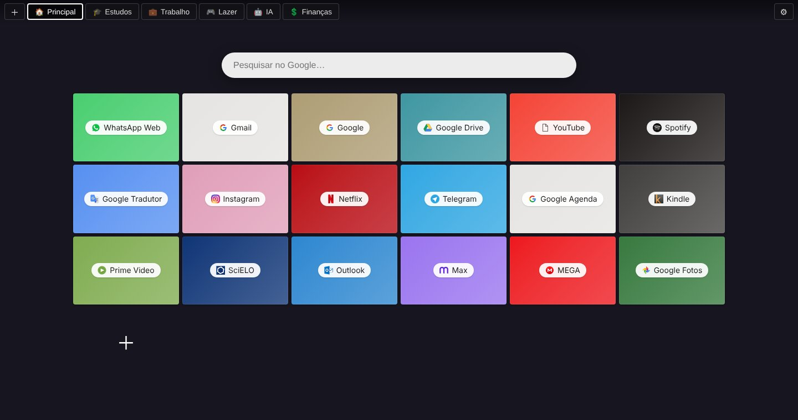
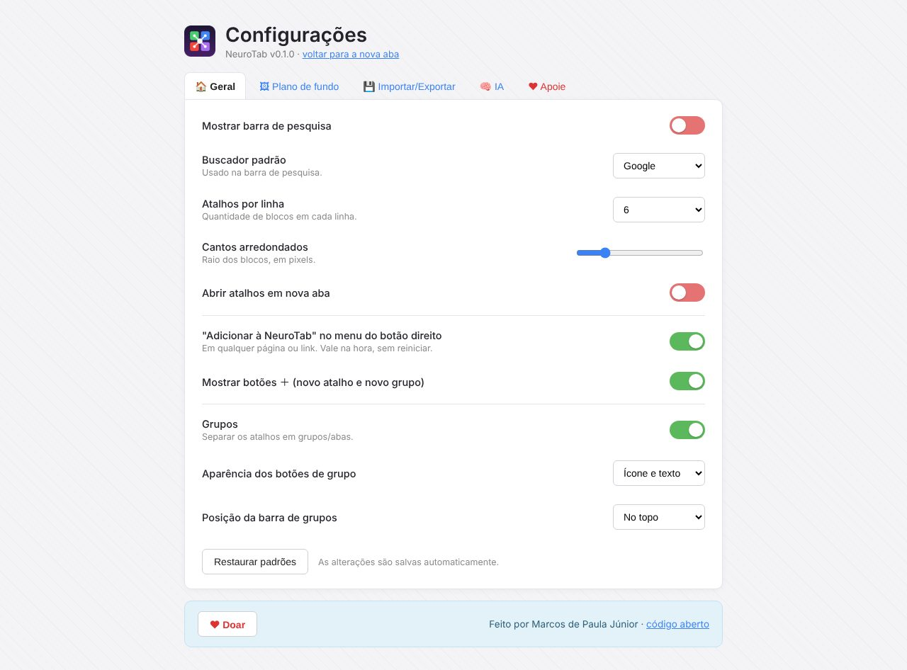

<p align="center">
  
</p>

<h1 align="center">NeuroTab</h1>

<p align="center">
  <b>Speed Dial para Edge e Chrome, com um segundo cérebro com IA a caminho.</b><br>
  Gratuita, de código aberto, sem anúncios e sem rastreamento.
</p>

<p align="center">
  <a href="https://github.com/mpjbiologo/NeuroTab/releases/latest"></a>
  
  
  <a href="LICENSE"></a>
</p>



A NeuroTab nasceu para substituir a extensão **Speed Dial**, que deixou de ser atualizada em 2022. Ela mantém o que funcionava (blocos coloridos, grupos e plano de fundo) e importa o backup antigo com tudo dentro. Nas próximas versões, vai ganhar um **segundo cérebro com IA**.

## ✨ O que já faz (v0.1)

- **Atalhos em blocos coloridos.** A cor é escolhida automaticamente a partir do ícone do site, e você pode mudar.
- **Grupos/abas** com emoji. Dá para arrastar e reordenar os grupos, ou soltar um atalho sobre outro grupo para movê-lo.
- **Arrastar e soltar:** reordene os atalhos ou solte um link vindo da barra de favoritos ou de outra aba.
- **Menu do botão direito** em qualquer página ou link: *Adicionar à NeuroTab → grupo*.
- **Ícone da extensão:** um clique adiciona a página atual.
- **Plano de fundo** com imagem otimizada automaticamente, cor e opção de escurecer.
- **Barra de pesquisa** opcional: Google, Bing, DuckDuckGo, Brave, Yandex ou Perplexity.
- **Importa o backup do Speed Dial (`.spd`)**, incluindo grupos, atalhos, cores, ícones e fundo. Também exporta e importa o backup da própria NeuroTab (`.json`).
- Excluir com **desfazer**, duplicar e editar atalhos.



## 📥 Instalação

### Pela release (recomendado enquanto não está nas lojas)

1. Baixe o `.zip` da [última versão](https://github.com/mpjbiologo/NeuroTab/releases/latest) e descompacte em uma pasta fixa. Não apague essa pasta depois.
2. Abra `edge://extensions` (no Chrome, `chrome://extensions`).
3. Ative o **Modo de desenvolvedor**.
4. Clique em **Carregar sem pacote** e escolha a pasta descompactada.
5. Abra uma nova aba. O Edge pergunta se você quer manter a alteração da nova aba: escolha **Manter alterações**.

### Pelo código-fonte

```bash
git clone https://github.com/mpjbiologo/NeuroTab.git
```

Depois, carregue a pasta clonada como no passo 4. O projeto não tem etapa de build: é HTML, CSS e JavaScript puros.

## 🔁 Vindo do Speed Dial?

1. No Speed Dial antigo, abra **Settings → Import/Export** e exporte o backup (arquivo `.spd`).
2. Na NeuroTab, abra **⚙ Configurações → Importar/Exportar → Escolher arquivo…** e selecione o `.spd`.
3. Pronto. Para não ter duas extensões disputando a nova aba, desative o Speed Dial antigo.

## 🗺 Roteiro

| Versão | O que vem |
|---|---|
| **v0.1** ✅ | Speed Dial completo e importação do `.spd` |
| **v0.2** | 🧠 Segundo cérebro: salvar trechos e páginas pelo botão direito, notas rápidas na nova aba, tags |
| **v0.3** | 🤖 IA: resumo automático, tags sugeridas, busca por significado e chat com as suas notas. Funciona com a sua chave (OpenAI, Anthropic ou Gemini) ou com a IA local do navegador |
| **v0.4** | Sincronização opcional, temas, atalhos de teclado, tradução da interface |
| — | Publicação na loja de complementos do Edge e na Chrome Web Store |

Ideias são bem-vindas nas [Issues](https://github.com/mpjbiologo/NeuroTab/issues).

## 🔒 Privacidade

Tudo fica **no seu navegador** (`chrome.storage.local`). A NeuroTab não tem servidor, não coleta dados e não usa analytics. Quando a IA chegar, as chamadas vão direto do seu navegador para o provedor que você escolher, com a sua chave.

**Permissões usadas:**

| Permissão | Para quê |
|---|---|
| `storage` / `unlimitedStorage` | Guardar atalhos e plano de fundo |
| `contextMenus` | Mostrar "Adicionar à NeuroTab" no botão direito |
| `activeTab` | Ler o título da página que você está adicionando |
| `favicon` | Mostrar o ícone dos sites |

## ❤ Apoie o projeto

A NeuroTab é feita nas horas vagas. Se ela é útil para você:

- ⭐ Dê uma estrela no repositório
- 🐛 [Relate problemas ou sugira ideias](https://github.com/mpjbiologo/NeuroTab/issues)
- 💸 Faça uma doação pela aba **❤ Apoie** nas configurações da extensão

> Para mantenedores: os links de doação ficam em [`src/config.js`](src/config.js) e em [`.github/FUNDING.yml`](.github/FUNDING.yml).

## 🛠 Desenvolvimento

```
manifest.json          Manifest V3
src/newtab.*           Página da nova aba
src/options.*          Configurações
src/background.js      Service worker (menu de contexto e ícone)
src/lib/store.js       Dados, importação do .spd, favicon e cor automática
src/config.js          Links do projeto e de doação
.github/workflows/     Gera o .zip e publica a release a cada tag v*
```

**Para lançar uma versão:**

1. Atualize `version` no `manifest.json` e o `CHANGELOG.md`.
2. Rode `git tag v0.1.0 && git push --tags`.

O GitHub Actions empacota a extensão e cria a release.

## 📄 Licença

[MIT](LICENSE) © Marcos de Paula Júnior

*A NeuroTab é um projeto independente. Ela não tem relação com os autores da extensão "Speed Dial" nem usa código dela. Apenas lê o formato de backup para facilitar a migração.*
