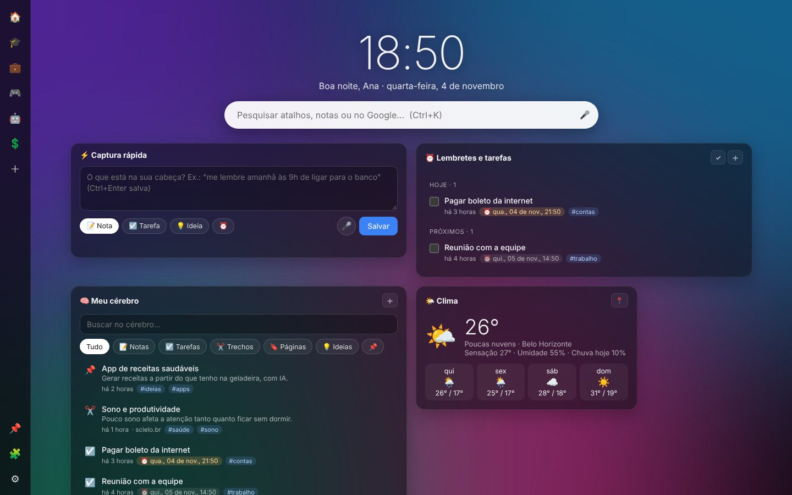
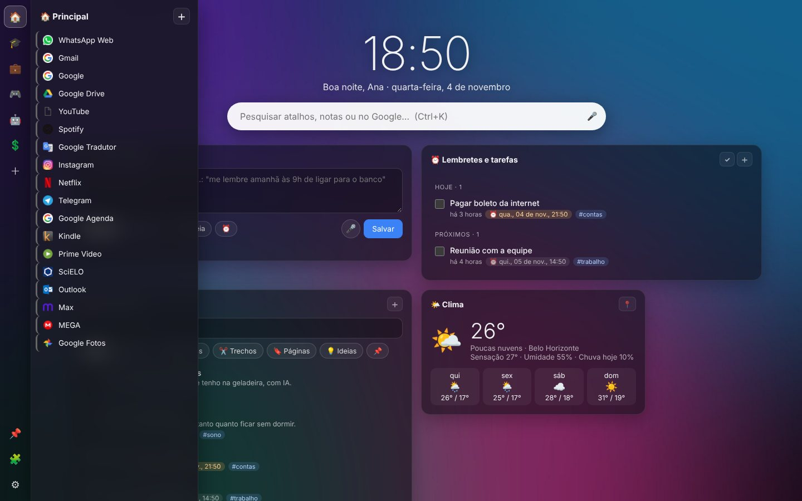
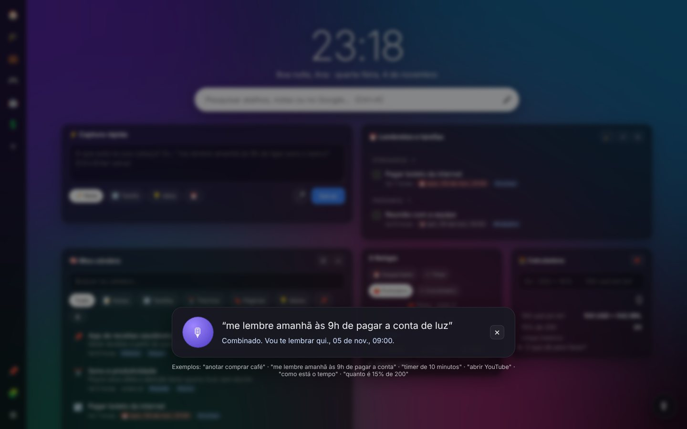
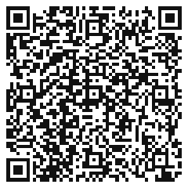

<p align="center">
  
</p>

<h1 align="center">NeuroTab</h1>

<p align="center">
  <b>A nova aba que pensa com você.</b><br>
  Atalhos numa barra lateral e, no centro, um segundo cérebro com notas, lembretes, clima, cotações e IA.<br>
  Para Edge, Chrome e Firefox, em português, inglês e espanhol. Gratuita, de código aberto, sem anúncios e sem rastreamento.
</p>

<p align="center">
  <a href="https://mpjbiologo.github.io/NeuroTab/"><b>🌐 Site do projeto</b></a> ·
  <a href="https://microsoftedge.microsoft.com/addons/detail/mhaainpmhalhhbefceigjmbcdhdeainl"><b>⬇ Edge</b></a> ·
  <a href="https://chromewebstore.google.com/detail/dbdilojkiedjgjehfjpodbljcnpmljkk"><b>⬇ Chrome</b></a> ·
  <a href="#-apoie-o-projeto"><b>❤ Apoiar</b></a>
</p>

<p align="center">
  <a href="https://github.com/mpjbiologo/NeuroTab/releases/latest"></a>
  
  
  <a href="LICENSE"></a>
</p>



A NeuroTab começou como substituta da extensão **Speed Dial**, que parou de ser atualizada em 2022, e importa o backup dela com tudo dentro. Na v0.2, o centro da tela virou um **segundo cérebro**: um lugar para capturar, lembrar e encontrar o que importa.

## ✨ Recursos

| | |
|---|---|
| 🗂️ **Barra de atalhos** | Grupos com emoji à esquerda, à direita, no topo ou no rodapé. Os atalhos abrem num painel ao passar o mouse. Dá para fixar o painel, arrastar e soltar, e as cores são automáticas |
| ⚡ **Captura rápida** | Anote digitando ou falando. Uma frase como *"me lembre amanhã às 9h de ligar para o banco"* vira lembrete sozinha |
| 🧠 **Meu cérebro** | Notas, trechos, páginas, tarefas e ideias, com busca, filtros, tags e itens fixados |
| ⏰ **Lembretes** | Notificações do sistema com os botões *Concluir* e *Adiar 10 min* |
| 🤖 **Pergunte ao seu cérebro** | Chat com a IA sobre o que você salvou, com citações das fontes. Também funciona por voz |
| ✂️ **Anotar páginas** | O ícone da extensão (ou **Alt+Shift+N**) abre um painel para anotar a página. O botão direito salva trechos, páginas e links |
| 🔎 **Ctrl+K** | Uma busca só para atalhos, notas, web e perguntas à IA. **Shift+Enter** salva o texto como nota |
| ⏱ **Relógio** | Despertador com dias da semana e soneca, timer, pomodoro e cronômetro, com som e notificação |
| 🧮 **Calculadora** | Contas, porcentagem ("200 + 10%"), conversões (moedas, medidas, temperatura, datas) e calculadoras de saúde opcionais |
| 🎙 **Comandos de voz** | **Alt+Shift+V** em qualquer aba: "anotar…", "me lembre amanhã às 9h…", "timer de 10 minutos", "abrir YouTube", "como está o tempo". Em português, inglês e espanhol; frases fora do padrão são interpretadas pela IA |
| 👂 **Palavra de ativação** *(experimental)* | Diga **"NeuroTab, …"** sem apertar nada. Desligada por padrão; só escuta com a nova aba aberta e em foco e desliga sozinha após um tempo sem uso |
| ✨ **Busca por significado** | "Aquela nota sobre sono" encontra "dormi mal". Usa embeddings do seu provedor de IA e melhora as respostas do "Pergunte ao cérebro" |
| 🌤 **Relógio e clima juntos** | O tempo fica ao lado da saudação, com previsão de 5 dias. Adicione outras cidades para ver a hora e o clima de cada fuso |
| 🗺 **Trânsito** | Mapa do Waze, seus locais favoritos (casa, trabalho…) e rotas salvas que abrem no Google Maps ou no Waze |
| 🖼 **Slides de fotos** | Fundo com fotos do seu PC, a foto do dia do Bing ou da NASA |
| ✅ **Hábitos, notícias e foco** | Hábitos com sequência de dias, feeds RSS e a tarefa principal do dia |
| 🌐 **Idiomas** | Português, inglês e espanhol, conforme o idioma do navegador (dá para trocar nas configurações), incluindo os comandos de voz |
| 🗑 **Lixeira e limpeza** | Seleção múltipla, limpar concluídas, lixeira de 30 dias |
| 📈🕘 **Mais widgets** | Clima, cotações, mais visitados e abas fechadas, atalhos em blocos. Arraste o canto ↘ para redimensionar e salve layouts com o 🧩. No **modo livre**, os widgets ficam em qualquer lugar da tela |
| 🔁 **Importar e exportar** | Importa o Speed Dial (`.spd`) e o Google Keep (via Takeout). Exporta as notas em Markdown e faz backup completo em `.json`, com a opção de incluir as chaves de API protegidas por senha |

<p align="center"> </p>

### 🤖 IA: use a que preferir
A IA é **opcional**. Ela organiza as notas (título, resumo, tags e lembrete) e responde perguntas sobre elas. Você usa a **sua chave**, e as chamadas vão direto do seu navegador para o provedor escolhido:

- **Google Gemini** (padrão, tem camada gratuita). Para obter uma chave: [aistudio.google.com/apikey](https://aistudio.google.com/apikey)
- **OpenAI** (ChatGPT) · **Anthropic** (Claude) · **OpenRouter** (centenas de modelos)
- **Ollama**, que roda no seu computador, offline e sem chave. Inicie com `OLLAMA_ORIGINS="chrome-extension://*" ollama serve`
- Qualquer API compatível com OpenAI: LM Studio, Groq, Mistral, DeepSeek…

Para configurar, abra **⚙ Configurações → IA e voz**, escolha o provedor, cole a chave e clique em **Salvar e testar**.

## 📥 Instalação

| Navegador | Onde instalar |
|---|---|
| **Microsoft Edge** | [Loja de complementos do Edge](https://microsoftedge.microsoft.com/addons/detail/mhaainpmhalhhbefceigjmbcdhdeainl) |
| **Google Chrome** | [Chrome Web Store](https://chromewebstore.google.com/detail/dbdilojkiedjgjehfjpodbljcnpmljkk): também serve para Brave, Vivaldi, Opera e outros navegadores baseados em Chromium |
| **Firefox** | Em breve (em análise na loja do Firefox) |

Clique em **Obter** (Edge) ou **Usar no Chrome** e abra uma nova aba. O navegador pergunta se você quer manter a nova página: clique em **Manter alterações**.

Pela loja, as **atualizações chegam sozinhas** e seus dados são mantidos.

### Firefox (enquanto não chega à loja)
Baixe o `neurotab-firefox.zip` da [última versão](https://github.com/mpjbiologo/NeuroTab/releases/latest), abra `about:debugging#/runtime/this-firefox` → **Carregar extensão temporária** e escolha o zip (ela some ao fechar o Firefox). Requer Firefox 128 ou mais novo.

### Instalação manual (avançado)
Para testar uma versão antes de ela chegar às lojas: baixe o `neurotab.zip` da [página de versões](https://github.com/mpjbiologo/NeuroTab/releases), descompacte numa pasta fixa, abra `edge://extensions` (ou `chrome://extensions`), ative o **Modo de desenvolvedor** e clique em **Carregar sem pacote**. Nesse caso a atualização é manual: a NeuroTab avisa quando sai versão nova.

> **Despertador e timer** tocam com o navegador aberto e o computador ligado — a extensão não consegue acordar o PC.

### Vindo do Speed Dial?
No Speed Dial antigo, vá em **Settings → Import/Export** e exporte o `.spd`. Na NeuroTab, vá em **Configurações → Backup** e escolha esse arquivo.

### Notas do Google Keep
O Google só libera a API do Keep para contas empresariais (Workspace). Para contas pessoais:
1. Em [takeout.google.com](https://takeout.google.com/), exporte só o **Keep**.
2. Na NeuroTab, abra **Configurações → Notas e integrações** e escolha a pasta `Takeout/Keep`.

## 🗺 Roteiro

| Versão | O que vem |
|---|---|
| **v0.1** ✅ | Speed Dial completo e importação do `.spd` |
| **v0.2** ✅ | Segundo cérebro: widgets, captura, lembretes, IA multi-provedor, voz, Keep, anotar páginas |
| **v0.3** ✅ | Widgets redimensionáveis e responsivos, relógio/despertador, calculadora, navegação, lixeira, comandos de voz, aviso de atualização |
| **v0.4** ✅ | Relógio + clima com várias cidades e fusos, trânsito com locais e rotas, slides de fotos, hábitos, notícias RSS, foco do dia, tradução (pt/en/es), versão para Firefox, material para as lojas |
| **v0.5** ✅ | Busca por significado, comandos de voz em inglês e espanhol, palavra de ativação (experimental), backup com chaves de API, biblioteca de imagens |
| **v0.6** ✅ | Fundação: testes automáticos e CI, migrações de dados, permissões sob demanda, chaves de API mais protegidas |
| **v0.7** | Maximizar/minimizar widgets, nome do assistente, agenda, imagens no cérebro |
| **Depois** | Agenda, sincronização entre computadores, Google Fotos e OneDrive nos slides, palavra de ativação offline |
| ✅ | Publicada nas lojas do [Edge](https://microsoftedge.microsoft.com/addons/detail/mhaainpmhalhhbefceigjmbcdhdeainl) e do [Chrome](https://chromewebstore.google.com/detail/dbdilojkiedjgjehfjpodbljcnpmljkk); Firefox em análise ([guias das lojas](docs/store/README.md)) |

Ideias são bem-vindas nas [Issues](https://github.com/mpjbiologo/NeuroTab/issues).

## 🔒 Privacidade

Tudo fica **no seu navegador**. A NeuroTab não tem servidor, não pede conta e não coleta dados. A chave da IA fica só no navegador e **só entra no backup se você pedir** (com senha opcional). Detalhes na [política de privacidade](https://mpjbiologo.github.io/NeuroTab/privacy.html).

A NeuroTab pede o mínimo na instalação (armazenamento, menus, lembretes e clima). Cotações, endereços do Trânsito, fotos do Bing/NASA, provedores de IA, feeds e imagens de sites são **pedidos só quando você usa o recurso**, e podem ser removidos em **Configurações → Geral → Permissões**. A lista completa, com o motivo de cada uma, está em [docs/dev/PERMISSOES.md](docs/dev/PERMISSOES.md). Sobre as chaves de API, veja [docs/dev/SEGURANCA.md](docs/dev/SEGURANCA.md).

## ❤ Apoie o projeto

A NeuroTab é feita nas horas vagas e vai continuar gratuita. Se ela é útil para você:



- **Pix:** `prof.marcosbiologo@gmail.com`. O QR Code ao lado também funciona, assim como a aba **❤ Apoie** nas configurações
- **Ko-fi:** [ko-fi.com/marcosdepaulajunior](https://ko-fi.com/marcosdepaulajunior) (cartão ou PayPal, de qualquer país)
- **PayPal:** [doar pelo PayPal](https://www.paypal.com/donate/?hosted_button_id=ZJ2SZQ4L5ZND4)
- ⭐ Dê uma estrela no repositório
- 🐛 [Sugira ideias ou relate problemas](https://github.com/mpjbiologo/NeuroTab/issues)

<br clear="right">

## 🛠 Desenvolvimento

O projeto não tem etapa de build: é HTML, CSS e JavaScript puros (módulos ES). O Node.js só é usado para os testes e o empacotamento.

```bash
npm ci && npx playwright install chromium
npm test        # testes de unidade + ponta a ponta (a extensão roda num Chromium de verdade)
```

Os mesmos testes rodam no GitHub a cada push e **antes de cada release** — se algo quebrar, a release não sai. Detalhes em [docs/dev/TESTES.md](docs/dev/TESTES.md); armazenamento e migrações em [docs/dev/ARMAZENAMENTO.md](docs/dev/ARMAZENAMENTO.md); navegadores suportados em [docs/dev/NAVEGADORES.md](docs/dev/NAVEGADORES.md).

```
manifest.json            Manifest V3
src/newtab.*             Nova aba (barra de atalhos, busca, widgets)
src/widgets/             Um arquivo por widget, registrados em index.js
src/popup.*              Painel do ícone (anotar página)
src/options.*            Configurações
src/background.js        Menus, lembretes (alarms) e notificações
src/lib/store.js         Atalhos, configurações, backup, importação do .spd
src/lib/migrations.js    Versões do esquema de dados e migrações
src/lib/permissions.js   Cada acesso a site e o recurso que o usa
src/lib/captures.js      Biblioteca de imagens (IndexedDB)
src/lib/brain.js         Notas, busca, lembretes em PT-BR, Keep, Markdown
src/lib/ai.js            Provedores de IA (Gemini, OpenAI, Anthropic, OpenRouter, Ollama…)
src/lib/pix.js           Pix copia e cola + QR Code
src/config.js            Links do projeto e dados do Pix
tests/                   Testes (unidade, ponta a ponta e dados de exemplo)
docs/                    Site do projeto (GitHub Pages) e documentação (docs/dev)
```

**Para criar um widget:** copie um arquivo de `src/widgets/`, exporte `{ id, title, icon, description, mount(el, ctx) }` e registre-o em `src/widgets/index.js`.

**Para lançar uma versão:**
1. Atualize `version` no `manifest.json` e o `CHANGELOG.md`, faça o commit e o push.
2. Espere o "Testes" ficar verde na aba Actions.
3. No GitHub, abra **Releases → Draft a new release**, crie a tag `vX.Y.Z` a partir da `main` e publique.

O Actions confere a versão, roda os testes de novo e anexa o `neurotab.zip` e o `neurotab-firefox.zip` à release.

## 📄 Licença

[MIT](LICENSE) © Marcos de Paula Júnior

*A NeuroTab é um projeto independente. Ela não tem relação com os autores da extensão "Speed Dial" nem usa código dela: apenas lê o formato de backup para facilitar a migração. O gerador de QR Code é de Kazuhiko Arase (MIT).*
